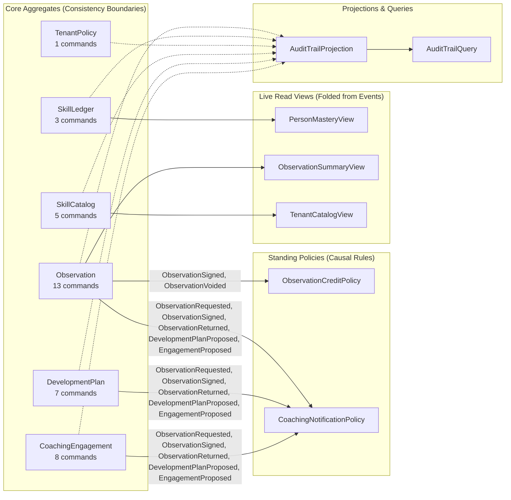

# Domain Model (`@alchemy.run/domain`)

> Generated directly from `packages/domain/src/model/Coaching.model.ts` by `pnpm docs:diagrams`. Do not edit by hand.
> Verified statically by `Domain.verify(CoachingModel)` (0 definition errors) and behaviorally by `Story.make` concurrent interleaving specs + formal invariant proofs.

## Bounded-Context Topology

## Aggregates, Commands & Events

### Observation

Observer-owned record of a demonstrated skill; SIGN is the sole credit source.

| Command                    | Emits Events                 | Typed Rejections                                                                   |
| -------------------------- | ---------------------------- | ---------------------------------------------------------------------------------- |
| `RequestObservation`       | `ObservationRequested`       | `AlreadyExists`, `UnauthorizedActor`, `InvalidDomainInput`                         |
| `StartObservation`         | `ObservationStarted`         | `AlreadyExists`, `UnauthorizedActor`, `InvalidDomainInput`                         |
| `SaveObservationDraft`     | `ObservationDraftSaved`      | `InvalidTransition`, `UnauthorizedActor`                                           |
| `SignObservation`          | `ObservationSigned`          | `InvalidTransition`, `UnauthorizedActor`, `PrivacyViolation`, `InvalidDomainInput` |
| `ReturnObservation`        | `ObservationReturned`        | `InvalidTransition`, `UnauthorizedActor`, `InvalidDomainInput`                     |
| `ResubmitObservation`      | `ObservationResubmitted`     | `InvalidTransition`, `UnauthorizedActor`                                           |
| `AcknowledgeObservation`   | `ObservationAcknowledged`    | `InvalidTransition`, `UnauthorizedActor`                                           |
| `RequestObservationReview` | `ObservationReviewRequested` | `InvalidTransition`, `UnauthorizedActor`, `InvalidDomainInput`                     |
| `UpholdObservation`        | `ObservationUpheld`          | `InvalidTransition`, `UnauthorizedActor`                                           |
| `VoidObservation`          | `ObservationVoided`          | `InvalidTransition`, `UnauthorizedActor`, `InvalidDomainInput`                     |
| `DeclineObservation`       | `ObservationDeclined`        | `InvalidTransition`, `UnauthorizedActor`, `InvalidDomainInput`                     |
| `WithdrawObservation`      | `ObservationWithdrawn`       | `InvalidTransition`, `UnauthorizedActor`                                           |
| `ExpireObservation`        | `ObservationExpired`         | none                                                                               |

### SkillLedger

Double-entry skill demonstration ledger & badge evaluator for one (tenant, person, skill).

| Command                | Emits Events                                            | Typed Rejections |
| ---------------------- | ------------------------------------------------------- | ---------------- |
| `RecordDemonstration`  | `DemonstrationRecorded`, `BadgeAwarded`                 | none             |
| `ReverseDemonstration` | `DemonstrationReversed`, `BadgeAwarded`, `BadgeRevoked` | none             |
| `ReevaluateStanding`   | `BadgeAwarded`, `BadgeRevoked`                          | none             |

### TenantPolicy

Firm-wide badge rigor criteria and observation logging window policy.

| Command              | Emits Events          | Typed Rejections                          |
| -------------------- | --------------------- | ----------------------------------------- |
| `UpdateTenantPolicy` | `TenantPolicyUpdated` | `UnauthorizedActor`, `InvalidDomainInput` |

### SkillCatalog

Immutable versioned skill definitions and level-up playbook resources.

| Command                  | Emits Events               | Typed Rejections                                              |
| ------------------------ | -------------------------- | ------------------------------------------------------------- |
| `PublishSkill`           | `SkillPublished`           | `AlreadyExists`, `UnauthorizedActor`, `InvalidDomainInput`    |
| `PublishSkillVersion`    | `SkillVersionPublished`    | `NotFoundInDomain`, `UnauthorizedActor`, `InvalidDomainInput` |
| `AttachPlaybookResource` | `PlaybookResourceAttached` | `NotFoundInDomain`, `UnauthorizedActor`, `InvalidDomainInput` |
| `RemovePlaybookResource` | `PlaybookResourceRemoved`  | `NotFoundInDomain`, `UnauthorizedActor`                       |
| `RetireSkill`            | `SkillRetired`             | `NotFoundInDomain`, `UnauthorizedActor`                       |

### DevelopmentPlan

Advisor focus-skill development plan lifecycle.

| Command                   | Emits Events               | Typed Rejections                                           |
| ------------------------- | -------------------------- | ---------------------------------------------------------- |
| `CreateDevelopmentPlan`   | `DevelopmentPlanCreated`   | `AlreadyExists`, `UnauthorizedActor`, `InvalidDomainInput` |
| `ProposeDevelopmentPlan`  | `DevelopmentPlanProposed`  | `InvalidTransition`, `UnauthorizedActor`                   |
| `AgreeDevelopmentPlan`    | `DevelopmentPlanAgreed`    | `InvalidTransition`, `UnauthorizedActor`                   |
| `EndorseDevelopmentPlan`  | `DevelopmentPlanEndorsed`  | `InvalidTransition`, `UnauthorizedActor`                   |
| `CompleteDevelopmentPlan` | `DevelopmentPlanCompleted` | `InvalidTransition`, `UnauthorizedActor`                   |
| `CancelDevelopmentPlan`   | `DevelopmentPlanCanceled`  | `InvalidTransition`, `UnauthorizedActor`                   |
| `ExpireDevelopmentPlan`   | `DevelopmentPlanExpired`   | none                                                       |

### CoachingEngagement

1:1 coaching engagement relationship lifecycle.

| Command              | Emits Events          | Typed Rejections                                           |
| -------------------- | --------------------- | ---------------------------------------------------------- |
| `ProposeEngagement`  | `EngagementProposed`  | `AlreadyExists`, `UnauthorizedActor`, `InvalidDomainInput` |
| `AcceptEngagement`   | `EngagementAccepted`  | `InvalidTransition`, `UnauthorizedActor`                   |
| `DeclineEngagement`  | `EngagementDeclined`  | `InvalidTransition`, `UnauthorizedActor`                   |
| `PauseEngagement`    | `EngagementPaused`    | `InvalidTransition`, `UnauthorizedActor`                   |
| `ResumeEngagement`   | `EngagementResumed`   | `InvalidTransition`, `UnauthorizedActor`                   |
| `EndEngagement`      | `EngagementEnded`     | `InvalidTransition`, `UnauthorizedActor`                   |
| `WithdrawEngagement` | `EngagementWithdrawn` | `InvalidTransition`, `UnauthorizedActor`                   |
| `ExpireEngagement`   | `EngagementExpired`   | none                                                       |

## Views, Policies, Projections & Queries

| Kind       | Name                         | Sources / Triggers                                                                                                  | Notes                                                                                              |
| ---------- | ---------------------------- | ------------------------------------------------------------------------------------------------------------------- | -------------------------------------------------------------------------------------------------- |
| View       | `PersonMasteryView`          | `SkillLedger`                                                                                                       | Live per-person skill mastery rings and held badges folded from SkillLedger.                       |
| View       | `ObservationSummaryView`     | `Observation`                                                                                                       | Live observation summary view with milestone events.                                               |
| View       | `TenantCatalogView`          | `SkillCatalog`                                                                                                      | Live firm skill catalog index folded from SkillCatalog authoring events.                           |
| Policy     | `ObservationCreditPolicy`    | `ObservationSigned`, `ObservationVoided`                                                                            | Posts credit on ObservationSigned and reverses credit + revokes unmet badges on ObservationVoided. |
| Policy     | `CoachingNotificationPolicy` | `ObservationRequested`, `ObservationSigned`, `ObservationReturned`, `DevelopmentPlanProposed`, `EngagementProposed` | Dispatches content-free coaching notifications via NotificationGateway.                            |
| Projection | `AuditTrailProjection`       | 18 event types                                                                                                      | Idempotently projects every auditable coaching fact into the tenant audit log.                     |
| Query      | `AuditTrailQuery`            | paged read                                                                                                          | Read a tenant’s chronological audit trail (admins & compliance reviewers).                         |

## Formal Verification Layers

1. **Static Graph Verification (`Domain.verify`)**: verifies zero missing `keyOf` routes, zero un-emitted policy triggers, zero duplicate writers, and valid initial states (`packages/domain/src/model/Coaching.story.test.ts`, server invariant `I25`).
2. **Concurrent Schedule Exploration (`Story.make`)**: replays multi-aggregate policies, projections, views, and stubbed external systems across concurrent interleavings in memory (`packages/domain/src/model/Coaching.story.test.ts`).
3. **State-Space & Algebraic Proofs**: exhaustive BFS over all 8 XState lifecycles plus 250 randomized `SkillLedger` histories verifying credit conservation, idempotency, privacy safety, policy monotonicity, and zero-PII events (`packages/domain/src/verification/formal.test.ts`).
