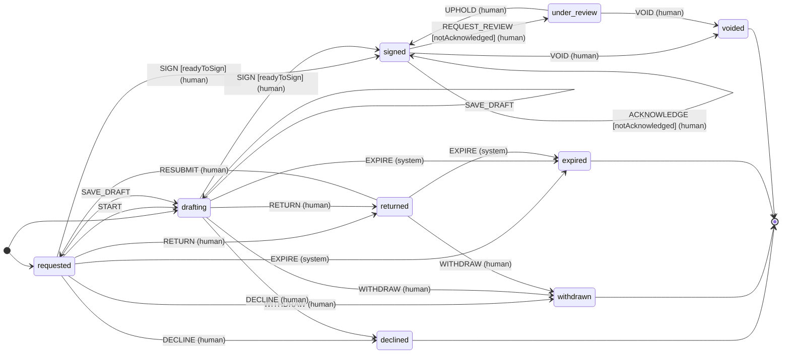
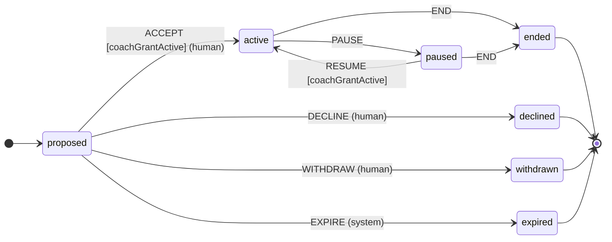
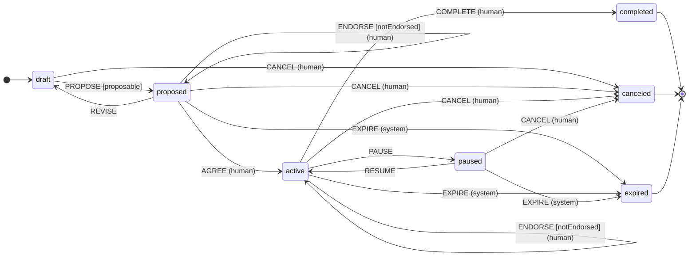
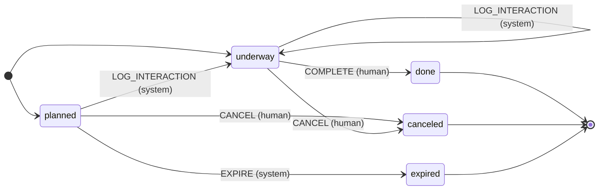
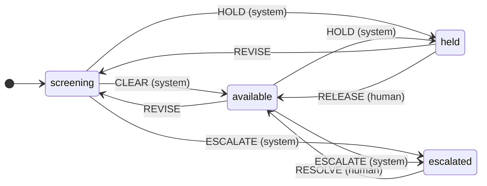
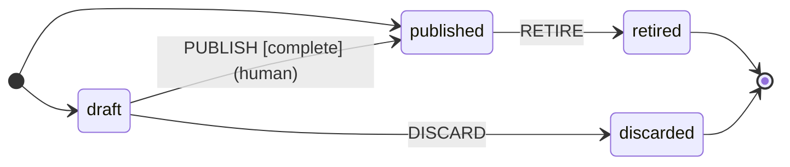
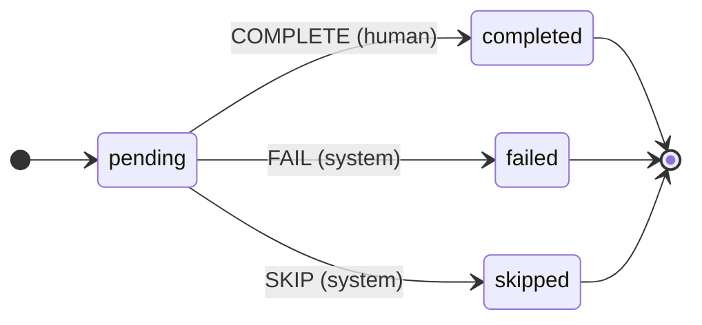
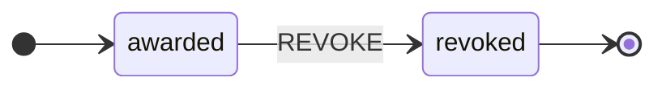
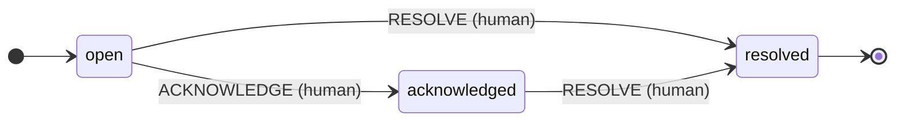

# Lifecycles

> Generated from `packages/domain/src/lifecycles/*.ts` by `pnpm docs:lifecycles`. Do not edit by hand.
> (human) = only a person can send it · (system) = sweep or automatic screening · `[guard]` = condition the machine evaluates.
> Who may send each human event is decided by policy (docs/architecture/identity-and-access.md § 5).

## observation

States: `requested`, `drafting`, `returned`, `signed`, `under_review`, `declined`, `withdrawn`, `expired`, `voided` · terminal: `declined`, `withdrawn`, `expired`, `voided`

## engagement

States: `proposed`, `active`, `paused`, `ended`, `declined`, `withdrawn`, `expired` · terminal: `ended`, `declined`, `withdrawn`, `expired`

## plan

States: `draft`, `proposed`, `active`, `paused`, `completed`, `canceled`, `expired` · terminal: `completed`, `canceled`, `expired`

## activity

States: `planned`, `underway`, `done`, `canceled`, `expired` · terminal: `done`, `canceled`, `expired`

## evidence

States: `screening`, `held`, `escalated`, `available` · terminal: none

## catalogItem

States: `draft`, `published`, `retired`, `discarded` · terminal: `retired`, `discarded`

## advisoryCheck

States: `pending`, `completed`, `failed`, `skipped` · terminal: `completed`, `failed`, `skipped`

## badgeAward

States: `awarded`, `revoked` · terminal: `revoked`

## directory exception

States: `open`, `acknowledged`, `resolved` · terminal: `resolved`

