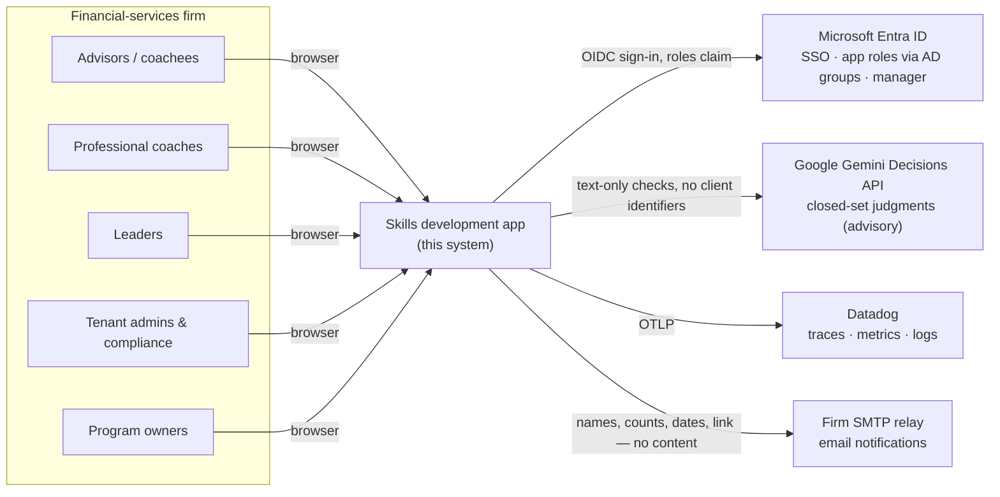
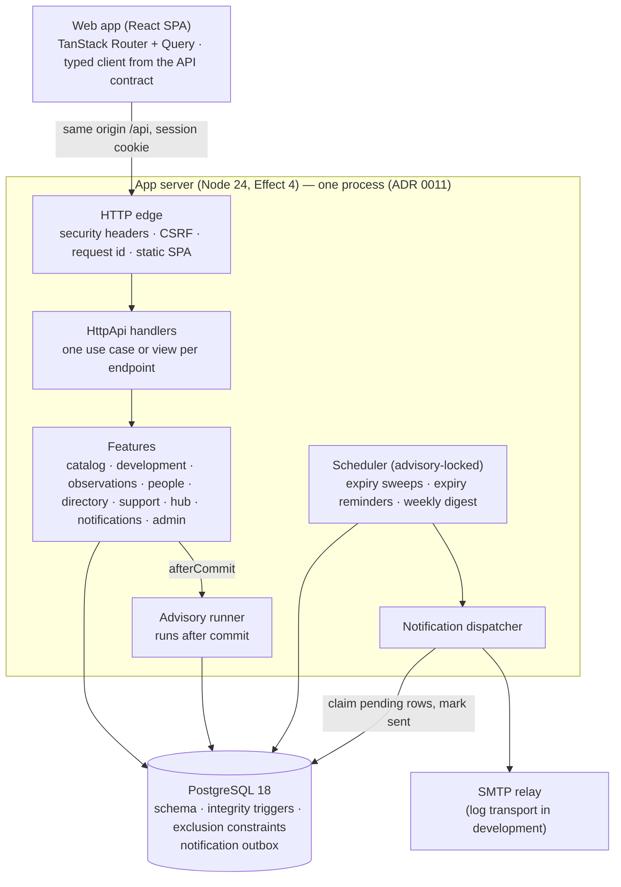
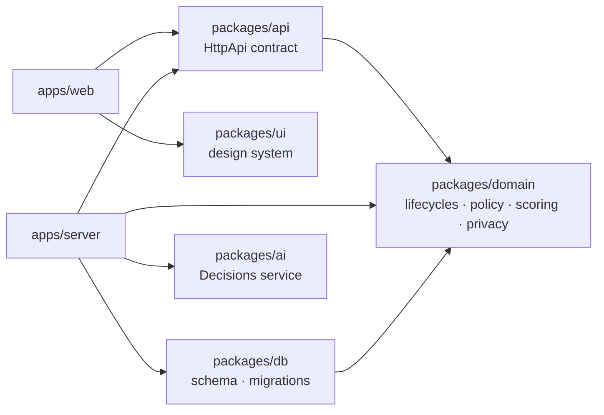
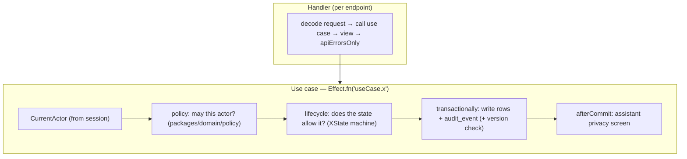
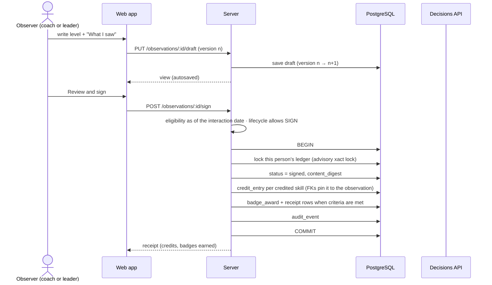
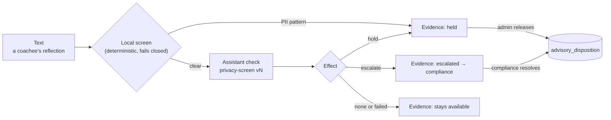
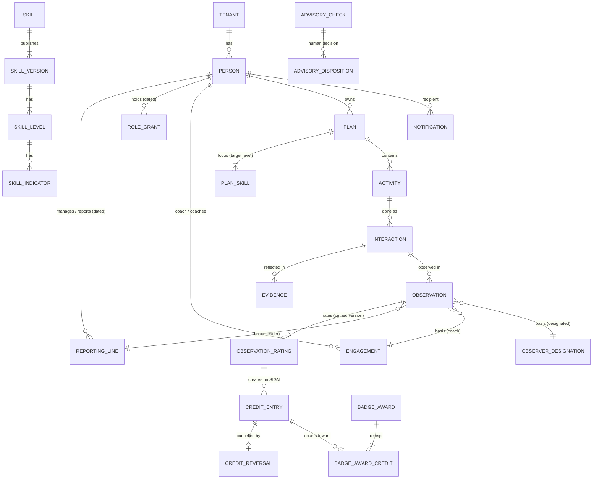
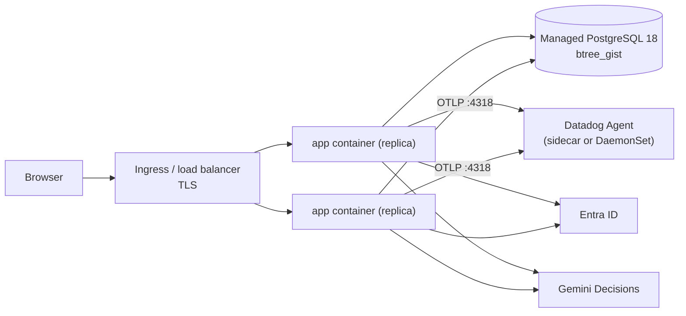

# Architecture overview

This is the one-page view of the system. Detail lives in
[the data model](data-model.md), [identity and access](identity-and-access.md),
[domain model graph](domain-model.md) (generated), [lifecycles](lifecycles.md)
(generated) and the [ADRs](../adr/README.md).

## 1. System context



## 2. Containers



**Packages and dependency direction.** The browser never imports server code:



## 3. Inside the server



`decide()` combines the policy check and the lifecycle check. A policy
refusal returns `Forbidden`. A lifecycle refusal returns `InvalidTransition`
with a human explanation. Anything the actor may not see returns `NotFound`.

## 4. Key flow: signing an observation



## 5. Assistant checks



## 5a. Notifications: the outbox

Built ([ADR 0018](../adr/0018-notifications-outbox-and-content-policy.md)).
Email is the only channel. `NOTIFY_TRANSPORT` picks `smtp` or `log` (the
default in development).

```mermaid
sequenceDiagram
  actor A as Advisor
  participant S as Server (use case)
  participant DB as PostgreSQL
  participant D as Dispatcher (scheduler fiber)
  participant M as SMTP relay (or log)
  actor O as Observer
  A->>S: ask Leo to observe
  S->>DB: BEGIN
  S->>DB: observation (requested) · audit_event
  S->>DB: notification (observation_requested, dedupe_key) — no free text
  S->>DB: COMMIT
  loop every minute; each row claimed with FOR UPDATE SKIP LOCKED
    D->>DB: pending rows past send_after
    D->>DB: recipient's preference (email on or off)
    D->>M: template(first name, display name, verb, date, link)
    D->>DB: status = sent (or skipped / failed, attempts + 1)
  end
  M-->>O: "Maya asked you to observe … open until Mon 30 Nov" + link
```

- A row exists if and only if the transition committed. Delivery is at least
  once.
- The weekly digest and the 48-hour expiry reminder are written by the
  scheduler, with dedupe keys, so a second replica or a rerun writes nothing
  new. The digest's numbers are computed when it is sent.

## 6. Data model (core)



The three kinds of tables follow different rules:

- **Directory mirrors** (dated): person, reporting line, role grant.
- **Workflow entities** (status plus version): plan, activity, observation,
  engagement, evidence.
- **Append-only facts** (enforced by triggers): credit, reversal, audit,
  `domain_event` journal, published catalog. A designation is a fact that may
  be ended once.
- **Operational** (deleted after 90 days): sessions, the notification outbox,
  preferences.

See the [data model](data-model.md).

## 7. Deployment



- **One image**, built from `apps/server/Dockerfile`, serves the API and the
  SPA. It runs read-only, as a non-root user, under tini, with a readiness
  check.
- Replicas are stateless. Sessions live in Postgres. The scheduler takes a
  transaction-scoped advisory lock, so only one replica sweeps at a time. The
  notification dispatcher claims rows with `FOR UPDATE SKIP LOCKED` instead.
- Operations: [incident response](../runbooks/incident-response.md),
  [deprovisioning](../runbooks/deprovisioning.md),
  [backup and restore](../runbooks/backup-and-restore.md).
- Migrations run at startup (`DB_MIGRATE_ON_START`) or as a separate release
  step.

## 8. Cross-cutting choices

| Concern              | Choice                                                                                      | ADR              |
| -------------------- | ------------------------------------------------------------------------------------------- | ---------------- |
| Language and runtime | TypeScript, Effect 4 (HttpApi, Schema, layers), Node 24                                     | 0002, 0003       |
| State                | XState machines, enforced server-side with pure transitions                                 | 0005             |
| Data                 | Postgres 18 + Drizzle's Effect driver; PGlite runs the same migrations in tests             | 0004             |
| Identity             | Entra OIDC; app roles mirrored to dated grants; relationships carry authority               | 0006, 0014       |
| Credit               | Only from SIGN; append-only demonstrations; badges by criteria                              | 0007             |
| AI                   | Advisory only; privacy screen only; explainable records; learning loop deferred             | 0008, 0015, 0016 |
| Privacy and audit    | No client PII; purgeable notes; append-only audit with `seq`                                | 0012, 0015       |
| Observability        | Effect native OTLP to Datadog                                                               | 0013             |
| Notifications        | Transactional outbox, dispatcher in the scheduler, no content in messages                   | 0018             |
| Coaching rhythm      | Deferred until pilot feedback: meetings stay in Outlook, next steps stay on the observation | 0019             |
| Observer supply      | Designated observers, bounded and anti-collusion                                            | 0020             |
| Adoption             | Program owner sees aggregates only, cells under five hidden                                 | 0021             |
| Domain & proofs      | `@alchemy.run/domain` fact model, 3-layer formal verification, zero-drift Mermaid diagrams  | 0023             |
| Catalog & voice      | Admin catalog authoring studio, core/common tiers, level-up playbooks, on-device voice note | 0024             |
