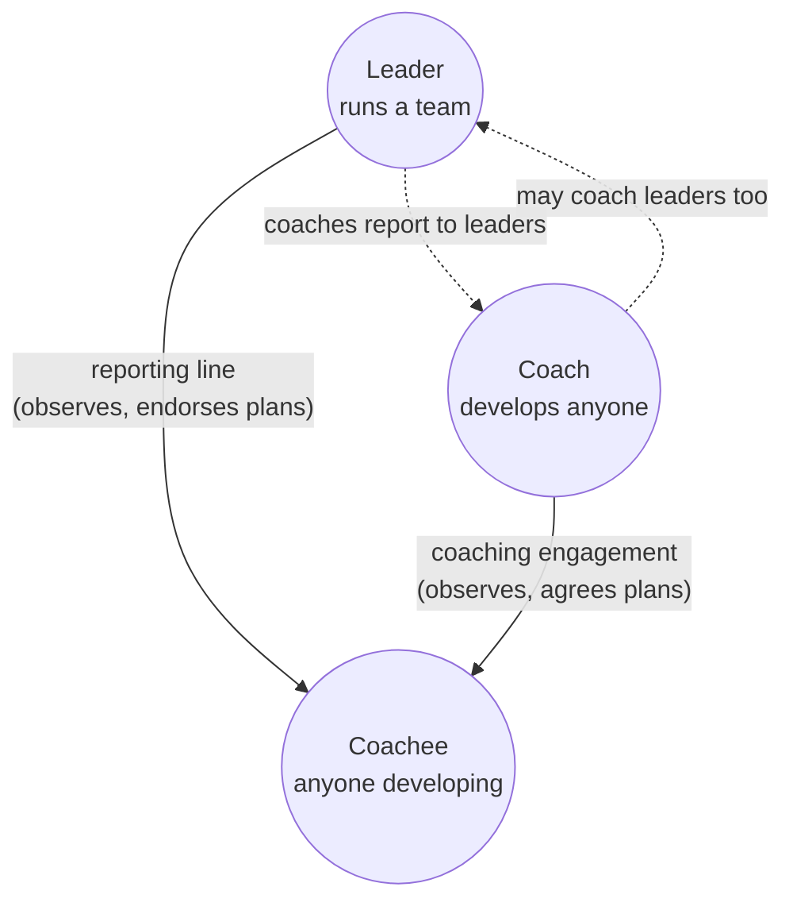
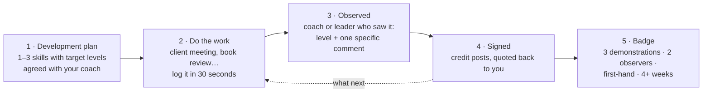
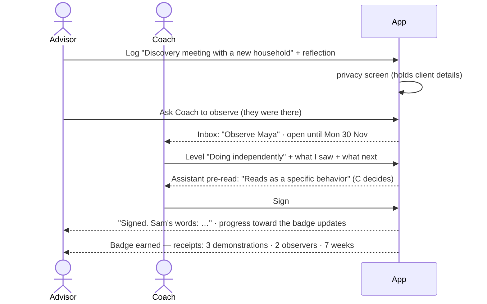

# Product overview

**A development program where skills grow through real work, and only what
someone actually saw counts.**

The firm names the skills that matter, such as client discovery, behavioral
coaching and trust. Advisors, coaches and leaders develop them in the course
of the job: client meetings, book reviews, team conversations. Credit is
given only when an eligible observer who saw the work signs an observation:
a coach, a leader, or a colleague they designated.
Recognition is earned, specific and explainable.

## Who it serves

- **Everyone can be developing.** A leader can have a coach and a plan of
  their own. These are relationships, not job titles.
- **Coaching is a mesh, not a hierarchy.** Any coach can coach anyone, and
  coaching carries no reporting authority.
- **Supporting roles:**
  - _Catalog keepers_ curate the skills.
  - _Tenant admins_ release privacy holds and see the audit trail.
    _Compliance reviewers_ resolve escalations and decide contested
    observations.
  - _Program owners_ see adoption in aggregate, never per person.

## The core loop

## What makes it different from the Salesforce coaching app

| Today (Salesforce Sales Programs / custom coaching objects) | Here                                                                                                 |
| ----------------------------------------------------------- | ---------------------------------------------------------------------------------------------------- |
| Progress counts logged CRM activity                         | Progress counts **observed** behavior, rated against a skill's levels                                |
| The rep chooses who reviews them                            | **Eligible observers only**: your coach or your direct leader, as of the date of the work            |
| No real skill model                                         | A **governed skill catalog** with levels and observable indicators, versioned                        |
| More data entry                                             | Log in 30 seconds; an observer signs in under a minute on a phone                                    |
| Opaque or gameable                                          | Every badge shows its **receipts**: who saw what, when, and why it counted                           |
| AI add-ons that score people                                | AI **only assists**. It flags privacy risks and helps observers be specific. It never grants credit. |

## Principles

1. **Observed evidence is the only currency.** No self-report, no points, no
   AI credit.
2. **Make the observer fast.** A level plus one specific comment is enough.
3. **Specific beats generic.** Recognition quotes the observer's own words.
4. **Many observations from many observers.** No single friendly signature
   earns a badge.
5. **Personal trajectory, not rank.** No leaderboards, streaks or rewards.
   Nothing is tied to pay.
6. **Private where it should be.** Narratives are seen only by the person,
   their coaches and their direct leader.
7. **Compliance by design.** No client names or account details. Everything
   is audited and explainable.

## Key journeys

Other journeys:

- **"I saw this"**: an observer starts an observation directly after
  watching good work.
- **Plan agreement**: a coachee proposes a plan; their coach agrees it; their
  leader may endorse it.
- **My team**: a leader sees coverage (who has been observed recently) and
  what is waiting on them. Never rankings.
- **Privacy hold**: a reflection with client details stays hidden until it is
  revised. A complaint or a specific recommendation goes to compliance.
- **Contest**: a coachee can acknowledge an observation or ask for a review.

## Status

| Area                                      | State                                                                                                                                              |
| ----------------------------------------- | -------------------------------------------------------------------------------------------------------------------------------------------------- |
| Domain rules, data model, API, auth, seed | Built and tested (Postgres 18)                                                                                                                     |
| Web app screens                           | In progress (see the [UX brief](ux-brief.md))                                                                                                      |
| Needs a domain decision                   | See [open questions](open-questions.md) and [questions for domain experts](domain-expert-questions.md)                                             |
| Built in this round                       | Designated observers (designate, end, observe on the `designated` basis); notification preferences; the schema for everything below                |
| Being built in this round                 | Notification outbox and weekly digest, Today and This-week bands on Home, conversations and commitments, the adoption view, a CSV directory import |
| Designed, not built                       | Cohorts, Graph directory sync, "Teaching others" pathway, private coach notes, calendar-assisted logging (ADR 0022, proposed)                      |
