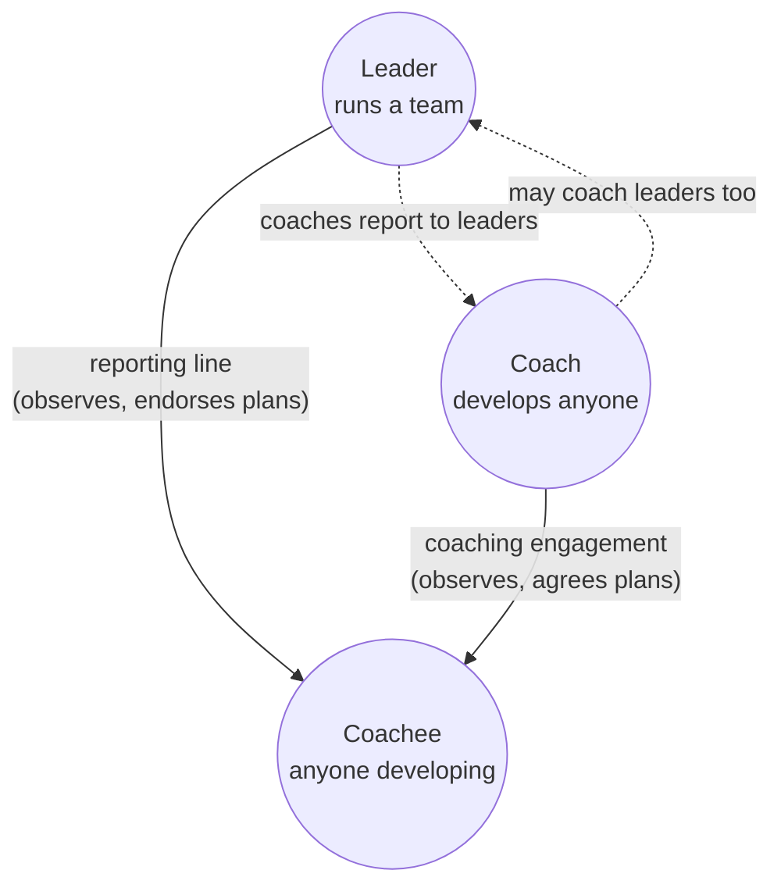
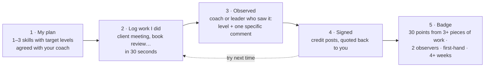
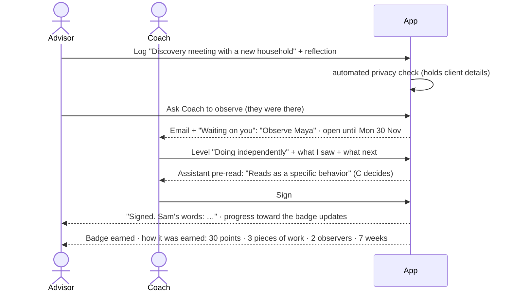

# Product overview

**A development program where skills grow through real work, and only what
someone actually saw counts.**

The firm names the skills that matter, such as client discovery, behavioral
coaching and trust. Advisors, coaches and leaders develop them in the course
of the job: client meetings, book reviews, team conversations. Credit is given
only when an eligible observer who saw the work signs an observation: the
person's coach or direct leader. Each signed credit is worth points: more
when the skill was the main focus of the work (primary), less when it was
used along the way (secondary). Recognition is earned, specific and
explainable.

## Why

The firm's current coaching tool (Salesforce Sales Programs and custom
coaching objects) counts logged CRM activity, depends on the coachee asking
for feedback, and has no real model of skills. People stop using it once the
mandate fades.

| Today                               | Here                                                                                                 |
| ----------------------------------- | ---------------------------------------------------------------------------------------------------- |
| Progress counts logged CRM activity | Progress counts **observed** behavior, rated against a skill's levels                                |
| The rep chooses who reviews them    | **Eligible observers only**: your coach or your direct leader, as of the date of the work            |
| No real skill model                 | A **governed skill catalog** with levels and observable indicators, versioned                        |
| More data entry                     | Log in 30 seconds; an observer signs in under a minute on a phone                                    |
| Opaque or gameable                  | Every badge shows **how it was earned**: who saw what, when, and why it counted                      |
| AI add-ons that score people        | AI **only assists**. It flags privacy risks and helps observers be specific. It never grants credit. |

## Who it serves

- **Everyone can be developing.** A leader can have a coach and a plan of
  their own. These are relationships, not job titles.
- **Coaching is a mesh, not a hierarchy.** Any coach can coach anyone, and
  coaching carries no reporting authority.
- **Supporting roles:** _tenant admins_ release privacy holds and see the
  audit trail; _compliance reviewers_ resolve escalations and decide contested
  observations; _program owners_ see adoption in aggregate, never per person,
  and maintain the credit rules, the skill catalog and the activity templates
  (ADR 0023).

## The core loop

Other journeys:

- **"I saw this"**: an observer records an observation directly after
  watching good work, in one screen, attached to the work the person already
  logged when there is some.
- **Plan agreement**: a coachee proposes a plan; their coach agrees it; their
  leader may endorse it.
- **My team**: a leader sees coverage (who has been observed recently) and
  what is waiting on them. Never rankings.
- **Privacy hold**: a reflection with client details stays hidden until it is
  revised. A complaint or a specific recommendation goes to compliance.
- **Returned request**: an observer can send a request back with a note; the
  coachee revises the reflection and resends it.
- **Contest**: a coachee can acknowledge an observation or ask for a review.

## Principles

1. **Observed evidence is the only currency.** No self-reported completion,
   no credit for logging, no AI-granted credit. Points exist only as the
   weight of a signed observation: a primary skill earns more than a
   secondary one, at values the firm's experts set, and a skill used as
   secondary often enough can earn its badge (ADR 0007).
2. **Make the observer fast.** A level plus one specific comment is enough;
   indicators are optional.
3. **Specific beats generic.** Narratives are nudged toward "the behavior I
   saw, its effect, the next step", and recognition quotes them back.
4. **Many observations from many observers.** No single friendly signature
   earns a badge: a points total alone is never enough, and one piece of work
   counts once however many people sign it.
5. **Personal trajectory, not rank.** No leaderboards, streaks or rewards.
   Points are never redeemable and never compared across people. Team views
   show coverage, never totals. Nothing is tied to pay.
6. **Roles are relationships.** One app adapts to the relationships a person
   has.
7. **Explicit lifecycles.** Every stateful thing is a tested state machine,
   and nothing waits forever: requests expire.
8. **AI may hold or advise, never clear.** Humans decide, and their decisions
   are recorded.
9. **Compliance by design.** No client names or account details, only opaque
   client references. Everything is audited and explainable; retention is
   explicit.
10. **Private where it should be.** The catalog and earned badges are visible
    tenant-wide. Progress is visible to the person, their coaches and their
    leader chain. Narratives are narrower: the person, the observer, their
    coaches and their direct leader.

## How we will know it works

The program owner's adoption view
([ADR 0021](../adr/0021-program-owner-and-adoption-view.md)) shows four
numbers, aggregates only, with any figure from fewer than five people hidden:

- people with an active plan;
- of those, how many were observed for work in the last 42 days (coverage);
- **median days from logging work to a signed observation**, the north star,
  because observer time limits the whole product;
- the share of observation requests that closed unsigned (expiry rate).

Nobody sees a per-person activity count, and there is no daily-active number
for advisors. Business outcomes such as client trust are studied in aggregate
and offline; they never feed recognition.

## Status

Nothing here is deployed or used by a client yet; there has been no pilot.
"Built" means built and tested in this repository.

| Area | State |
| --- | --- |
| Domain rules, data model, API, auth, seed | Built and tested (Postgres 18) |
| Web app | Built: Home, My plan, To sign, My team, People I coach, Skills, Adoption, Credit rules, Skill catalog, Activity templates, Assistant checks, Audit trail. See [DESIGN.md](../../apps/web/DESIGN.md) |
| Weighted signed credit | Built: roles, points frozen at signing, one piece of work counted once, badge criteria and legacy conversion (ADR 0007). The values are working defaults awaiting the firm's experts ([open questions](open-questions.md) 26 to 35) |
| Credit rules and catalog | Built: program owners and tenant admins change the credit rules, skills (with immutable published versions) and activity templates at run time, with an audit record (ADR 0023) |
| Plans | Built: edit, revise and agree again, add and edit work with roles, individual values, closing review |
| Notifications | Email (immediate and a weekly digest) through the notification outbox, delivered at least once; two settings: email on or off, digest on or off |
| Assistant privacy screen | Built. Runs on a deterministic mock unless configured otherwise (`DECISIONS_MODE` defaults to `mock`; `disabled` turns it off). Live mode needs an API key and the paid-tier confirmation, and waits for infosec and compliance (open question 15) |
| Directory | CSV import with a dry run (API only); Graph sync waits for IT |
| Behind a switch, off by default | Designated observers (`FEATURE_DESIGNATED_OBSERVERS`, [ADR 0020](../adr/0020-designated-observers.md)) |
| Not built | Level 4 badges, waivers, reciprocal-pair exclusion, purge jobs, Graph directory sync, coaching conversations (ADR 0019), skill profiles (ADR 0017), the AI learning loop (ADR 0016), calendar logging (ADR 0022). See the [backlog](../backlog.md) |
| Needs a client decision | See [open questions](open-questions.md) and [questions for domain experts](domain-expert-questions.md) |
